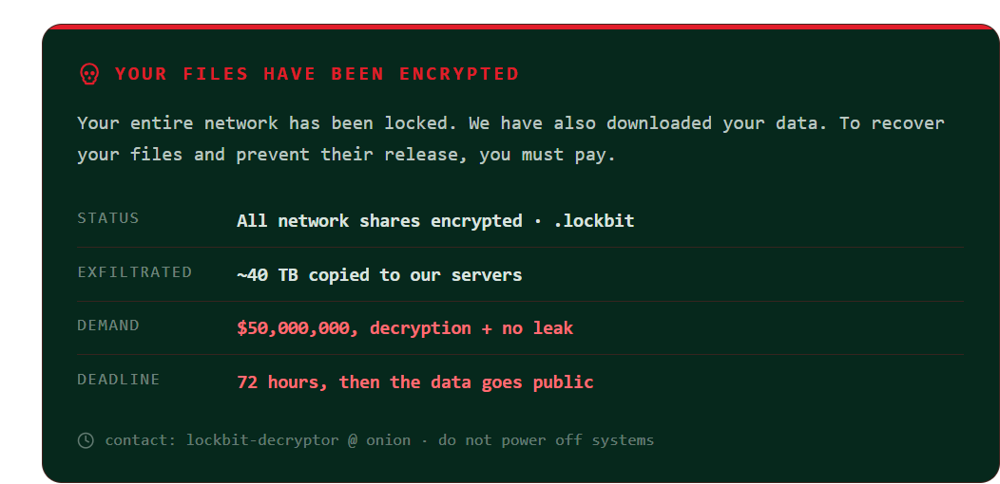
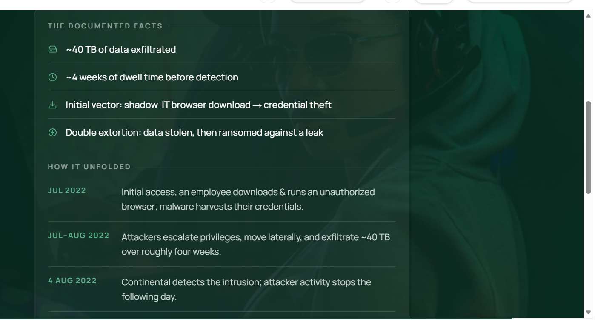

# SOC Incident Investigation & Response Simulation

**Platform:** ProoV - Fundamentals of Cybersecurity  
**Scenario organisation:** Falkenstein Automotive GmbH (fictional)  
**Assessment:** 84/100, as reported in the simulation results

## Overview
This repository documents a simulated phishing-led compromise that progressed to malware installation, credential theft, a suspicious sign-in from Rotterdam at 02:14, access to information across HR, Procurement, Finance and Engineering, and a subsequent ransomware event.

The project records the analyst workflow: incident reconstruction, log and identity analysis, containment, breach communication and lessons learned.

> **Simulation notice:** Falkenstein Automotive GmbH is fictional. This is a training simulation, not an investigation performed for a real organisation. Scenario statements are not equivalent to independently verified forensic findings.

## Scenario and response
An employee opened a phishing email and executed a malicious attachment. Malware was installed on the host and the user's password was stolen. The compromised identity was then used to sign in from Rotterdam at 02:14, described by the scenario as impossible travel. The account's access rights extended to information in HR, Procurement, Finance and Engineering. Ransomware followed.

The response described in the simulation included isolating and quarantining the affected endpoint, blocking attacker access through firewall controls and resetting the affected account's password.

## Work documented
- Phishing-led initial access and malicious attachment execution.
- Credential compromise and anomalous authentication.
- Access scope and potential cross-department exposure.
- Ransomware impact and containment.
- Cyber Kill Chain reconstruction.
- MITRE ATT&CK mapping and hunting priorities.
- GDPR Article 33 notification exercise.
- Executive incident report and lessons learned.
- 
## Repository structure
- * [**incident overview**](docs/incident-overview.md) – scope, facts and impact
- * [**incident timeline**](docs/incident-timeline.md) – event sequence and evidence status
- * [**Attack vector analysis**](docs/attack-reconstruction.md) – Cyber Kill Chain analysis
- * [**Attack Mapping**](docs/mitre-attack-mapping.md) – ATT&CK mapping and hunting leads
- * [**Attack response**](docs/containment-and-response.md) – response and validation
- * [**Compliance Breach notification draft**](docs/gdpr-breach-notification.md) – training notification draft
- * [**Executive report**](docs/executive-incident-report.md) – leadership-facing report
- * [**Lessons Learned**](docs/lessons-learned.md) – control gaps and recommendations
- 
- 
- * [**Certificates earned**](certificates/Project-completion-certificate.pdf) – certificate issued
- * [**Project Evaluation Report**](certificates/Project-evaluation-report.pdf)

## Frameworks
The Cyber Kill Chain explains the attack's progression. MITRE ATT&CK organises observed or suspected behaviours into tactics and techniques to guide hunting. GDPR Article 33 informs the breach-notification exercise. The NIST incident-response lifecycle provides a reference for response phases.

Technique IDs were assigned only where supported by scenario evidence

## Limitations
Specific details such as malware family and exfiltration volume were outside the scope of the provided scenario

## Author
**Patricia Stephanie** · [GitHub profile](https://github.com/PatriciaStephanie5)
